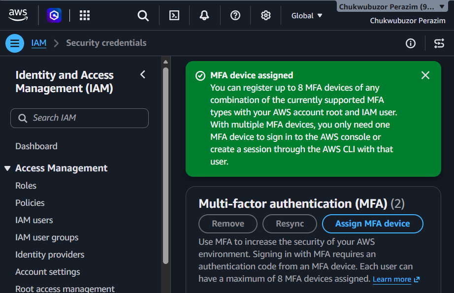
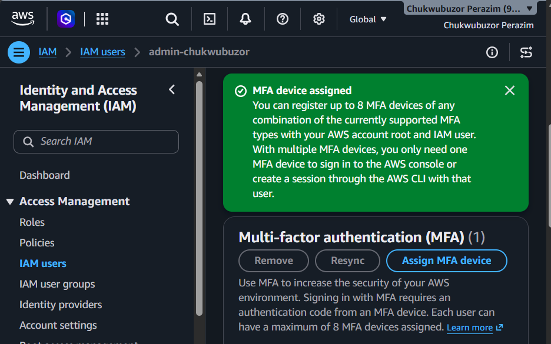
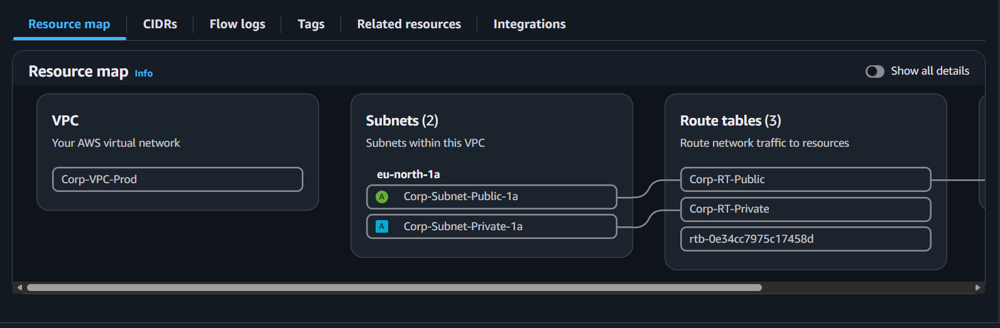
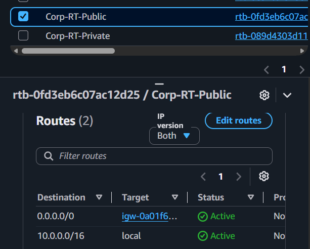
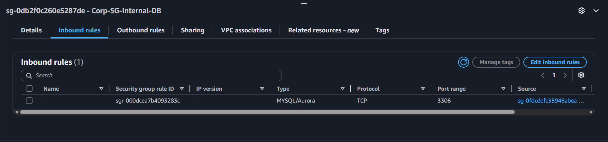
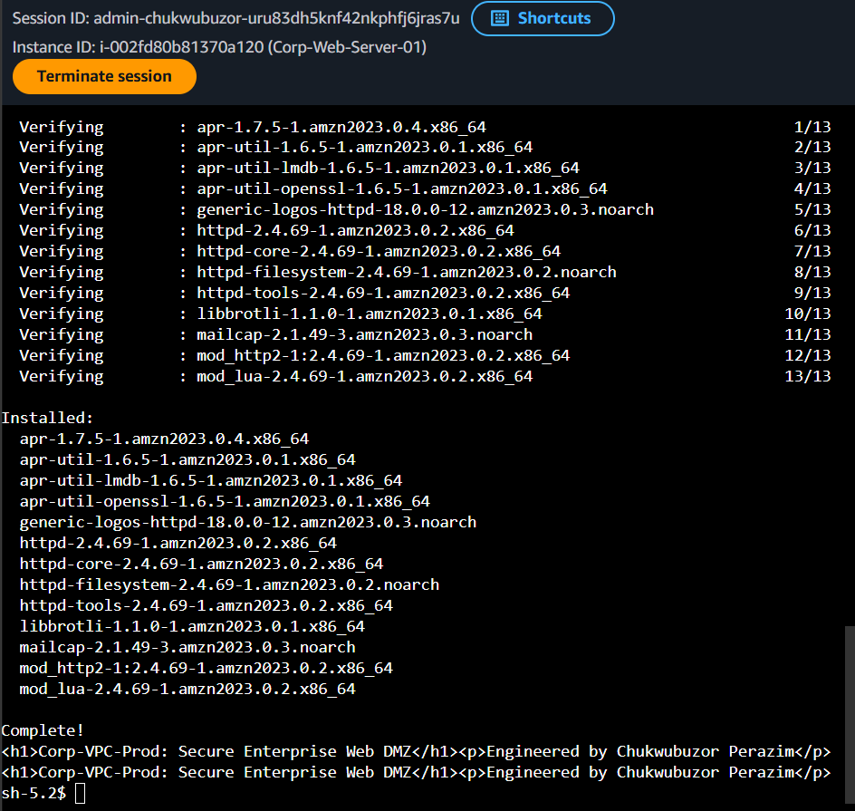
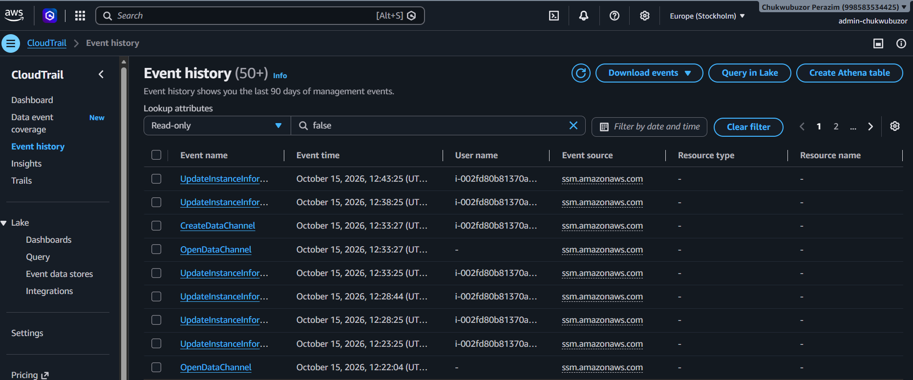

# Enterprise Cloud Infrastructure: Multi-Tier VPC Architecture, Least-Privilege IAM Hardening & Zero-Trust Systems Management

[](https://aws.amazon.com/)
[](https://docs.aws.amazon.com/vpc/)
[](https://aws.amazon.com/iam/)
[-success)](https://docs.aws.amazon.com/systems-manager/)
[](https://aws.amazon.com/cloudtrail/)
[](https://github.com/ChukwubuzorPerazim)

---

## 1. Executive Summary & Problem Statement

Modern enterprise infrastructure increasingly resides within public cloud environments. However, misconfigured cloud perimeters, unsegmented virtual networks, unrotated access keys, and overly permissive Identity and Access Management (IAM) policies consistently rank as the primary attack vectors for enterprise data breaches (e.g., Capital One, Uber).

This project designs and implements an enterprise-grade **Cloud Security Architecture on Amazon Web Services (AWS)** following the **AWS Well-Architected Framework (Security Pillar)**. It establishes strict root-account perimeter controls, architects a segregated **Multi-Tier Virtual Private Cloud (VPC)** with public DMZ and isolated private tiers, implements **Stateful Security Group Chaining**, eliminates public SSH/RDP attack surfaces via **AWS Systems Manager (SSM) Session Manager**, and establishes immutable administrative auditing through **AWS CloudTrail**.

### Key Objectives Accomplished:
* **Root Account Hardening & Financial Safeguards:** Enforced hardware/virtual Multi-Factor Authentication (MFA) on the root identity, eliminated permanent root access keys, and deployed automated zero-spend budget alerts ($0.01 threshold).
* **Identity Governance & Least-Privilege IAM:** Provisioned dedicated administrator identity `admin-chukwubuzor` under the `Cloud-Engineers` group, enforced complex password rotation policies, and eliminated dangerous `"Action": "*"` permissions in favor of scoped role-based access control.
* **Multi-Tier VPC Architecture:** Engineered custom VPC `Corp-VPC-Prod` (`10.0.0.0/16`) spanning distinct public DMZ subnets (`10.0.1.0/24`) and private application subnets (`10.0.2.0/24`) with strict route-table segregation.
* **Stateful Security Group Chaining:** Implemented zero-trust network isolation by allowing database ingress strictly from the cryptographic Security Group ID of the Web DMZ tier rather than static CIDR blocks.
* **Zero-Trust Compute Management (SSM):** Attached instance profile `Corp-EC2-SSM-Role` enabling full interactive shell administration of compute instances with **zero inbound ports (Port 22/3389) open** to the internet.
* **Continuous Cloud Governance & Audit Logging:** Deployed multi-region **AWS CloudTrail** streaming management events to an encrypted S3 bucket for non-repudiation and forensic incident response.

---

## 2. Infrastructure Architecture & Topology

```
+-----------------------------------------------------------------------------------+
|                           AWS REGIONAL CLOUD BOUNDARY                             |
|                                                                                   |
|  +-----------------------------------------------------------------------------+  |
|  |             Corp-VPC-Prod (IPv4 CIDR Block: 10.0.0.0/16)                    |  |
|  |                                                                             |  |
|  |   [ Internet Gateway: Corp-IGW-Prod ] <----+                                |  |
|  |                                            | Egress Default Route           |  |
|  |   +----------------------------------------+----------------------------+   |  |
|  |   | PUBLIC WEB DMZ TIER                                                 |   |  |
|  |   | Subnet: Corp-Subnet-Public-1a (CIDR: 10.0.1.0/24)                   |   |  |
|  |   | Routing: 0.0.0.0/0 -> Corp-IGW-Prod                                 |   |  |
|  |   | Security Group: Corp-SG-Web-DMZ                                     |   |  |
|  |   |   • Ingress: HTTP (80), HTTPS (443) from 0.0.0.0/0                  |   |  |
|  |   |   • Ingress: SSH (22) strictly locked to Admin IP                   |   |  |
|  |   | Compute: Corp-Web-Server-01 (Apache HTTP Server)                    |   |  |
|  |   +------------------------------------+--------------------------------+   |  |
|  |                                        |                                    |  |
|  |                                        | Internal Traffic Flow              |  |
|  |                                        v (Security Group Chaining)          |  |
|  |   +---------------------------------------------------------------------+   |  |
|  |   | ISOLATED PRIVATE DATA TIER                                          |   |  |
|  |   | Subnet: Corp-Subnet-Private-1a (CIDR: 10.0.2.0/24)                  |   |  |
|  |   | Routing: Local VPC Routing Only (10.0.0.0/16 -> local)              |   |  |
|  |   | Security Group: Corp-SG-Internal-DB                                 |   |  |
|  |   |   • Ingress: MySQL (3306) ONLY from sg-xxxx (Corp-SG-Web-DMZ)       |   |  |
|  |   |   • Zero Public Internet Ingress / Zero Direct Ingress from Web     |   |  |
|  |   +---------------------------------------------------------------------+   |  |
|  +-----------------------------------------------------------------------------+  |
|                                                                                   |
|  +-----------------------------------------------------------------------------+  |
|  | CLOUD GOVERNANCE & ZERO-TRUST MANAGEMENT PLANE                              |  |
|  |  • IAM Admin User: admin-chukwubuzor (Virtual MFA Enforced)                 |  |
|  |  • IAM Instance Role: Corp-EC2-SSM-Role (AmazonSSMManagedInstanceCore)     |  |
|  |  • AWS CloudTrail: Multi-Region Management Event Logging to S3              |  |
|  |  • Zero-Spend Budget: $0.01 Automated Anomaly Alert Threshold               |  |
|  +-----------------------------------------------------------------------------+  |
+-----------------------------------------------------------------------------------+
```

---

## 3. Network & Security Parameter Matrix

| Architectural Layer | Resource Identifier | CIDR / Configuration | Firewall / Ingress Policy | Egress / Routing Policy |
| :--- | :--- | :--- | :--- | :--- |
| **Virtual Private Cloud** | `Corp-VPC-Prod` | `10.0.0.0/16` | DNS Resolution: Enabled | DNS Hostnames: Enabled |
| **Public DMZ Subnet** | `Corp-Subnet-Public-1a` | `10.0.1.0/24` | Auto-assign Public IP: Yes | Route Table: `Corp-RT-Public` |
| **Private Subnet** | `Corp-Subnet-Private-1a` | `10.0.2.0/24` | Auto-assign Public IP: No | Route Table: `Corp-RT-Private` (Local) |
| **Internet Gateway** | `Corp-IGW-Prod` | Attached to VPC | State-Managed Egress | Target for `0.0.0.0/0` in Public RT |
| **Web DMZ Firewall** | `Corp-SG-Web-DMZ` | Security Group | Port 80/443 (Any), Port 22 (Admin IP) | Outbound: All Traffic (0.0.0.0/0) |
| **Database Firewall** | `Corp-SG-Internal-DB`| Security Group | Port 3306 ONLY from `Corp-SG-Web-DMZ` | Outbound: Default |
| **Zero-Trust Access** | `Corp-EC2-SSM-Role` | IAM Instance Profile | `AmazonSSMManagedInstanceCore` | Zero Inbound Open Ports Required |
| **Auditing & Logging** | `Corp-CloudTrail-Audit`| Multi-Region Trail | Management Events (Read/Write) | Encrypted S3 Destination Bucket |

---

## 4. Verification & Testing Evidence

### Test 1: AWS Account Hardening & Root MFA Enforcement

*Figure 1: AWS IAM Security Credentials console for account holder `Chukwubuzor Perazim` confirming Root Multi-Factor Authentication (MFA) enforcement with active MFA devices assigned, protecting the root identity from credential compromise.*

---

### Test 2: IAM Operational Administrator Provisioning & MFA Hardening

*Figure 2: AWS IAM console confirming the dedicated operational administrator identity `admin-chukwubuzor` has been provisioned and fortified with an active Virtual MFA device, enforcing least-privilege non-root operations.*

---

### Test 3: Multi-Tier VPC Segmentation & Resource Topology Map

*Figure 3: AWS VPC Resource Map displaying `Corp-VPC-Prod` with verified architectural tiering in Availability Zone `eu-north-1a`: Public DMZ subnet (`Corp-Subnet-Public-1a`) bound to `Corp-RT-Public` alongside isolated Private Data subnet (`Corp-Subnet-Private-1a`) bound to `Corp-RT-Private`.*

---

### Test 4: Route Table Egress Segregation (Public vs. Private)

*Figure 4: AWS Route Tables console for `Corp-RT-Public` (`rtb-0fd3eb6c07ac12d25`) verifying active default egress routing: `0.0.0.0/0` targeted to Internet Gateway `igw-0a01f6...` alongside local VPC routing (`10.0.0.0/16`).*

---

### Test 5: Stateful Security Group Chaining

*Figure 5: Inbound firewall rules for `Corp-SG-Internal-DB` (`sg-0db2f0c260e5287de`) demonstrating Security Group Chaining: MySQL/Aurora (port 3306) ingress restricted exclusively to the source Security Group ID of `Corp-SG-Web-DMZ` (`sg-0fdcdefc35946abea...`).*

---

### Test 6: Zero-Trust Management via AWS Systems Manager (SSM) Session Manager

*Figure 6: Interactive browser-based shell established into `Corp-Web-Server-01` via AWS Systems Manager Session Manager under authenticated IAM identity `admin-chukwubuzor`, verifying zero open inbound management ports (SSH Port 22 closed), verified outbound package repository connectivity, and active web service response displaying custom engineering signature.*

---

### Test 7: Immutable CloudTrail Governance & Audit Logging

*Figure 7: AWS CloudTrail Event History console for account `Chukwubuzor Perazim (998583534425)` under operational identity `admin-chukwubuzor`, verifying immutable auditing telemetry capturing real-time Systems Manager session negotiations (`CreateDataChannel`, `OpenDataChannel`) and agent updates (`UpdateInstanceInformation`) for compute instance `i-002fd80b81370a120`.*

---

## 5. Security & Engineering Considerations

1. **Defense-in-Depth via Security Group Chaining vs. Static IP Filtering:**  
   In dynamic cloud architectures, instances scale up and down dynamically (Auto Scaling). Hardcoding IP addresses in firewall rules introduces maintenance debt and security drift. By chaining Security Groups (referencing `sg-xxxx` as the rule source), any compute instance launched within the Web tier is automatically granted database access, while any unauthorized instance or external IP is dropped at Layer 4 regardless of its network location.
2. **Eliminating the Bastion Host Anti-Pattern with AWS Systems Manager (SSM):**  
   Traditional cloud setups deploy a "Jump Box" or "Bastion Host" with SSH (port 22) exposed to the public internet. This creates a high-profile attack surface subject to credential stuffing, SSH zero-day exploits, and SSH private key management burdens. AWS Systems Manager Session Manager communicates over outbound HTTPS (port 443) to AWS private service endpoints using ephemeral IAM authentication tokens, completely eliminating public attack surfaces and external key management.
3. **The Principle of Least Privilege in Identity Architecture:**  
   The AWS Root user possesses unrestricted, un-auditable power over all account resources. By locking Root credentials behind multi-factor authentication and establishing scoped role-based access for operational personnel, organizations minimize the blast radius of credential compromise and satisfy regulatory compliance baselines (SOC 2, ISO 27001).

---

## 6. Author Information

* **Engineer:** Chukwubuzor Perazim
* **Certifications:** AWS Certified Cloud Practitioner
* **Specialization:** Cloud Security Architecture, Network Perimeter Defense & Infrastructure Automation
* **Location:** Warri, Delta State, Nigeria
* **LinkedIn:** [linkedin.com/in/ChukwubuzorPerazim](https://www.linkedin.com/in/chukwubuzor-perazim-590a5519a/)
* **GitHub:** [github.com/ChukwubuzorPerazim](https://github.com/Perazimy)

